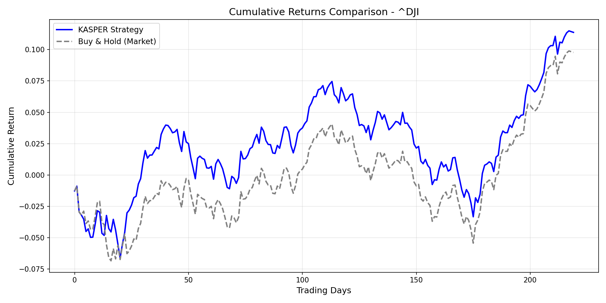

# KASPER: Kernel-based Adaptive Spline-activated Probabilistic Extreme Regime

[](https://arxiv.org/abs/2507.18983)
[](https://www.python.org/downloads/)
[](https://pytorch.org/)

KASPER is a high-fidelity financial forecasting framework that leverages **Kolmogorov-Arnold Networks (KANs)** for dual-stage regime detection and adaptive forecasting. This implementation strictly adheres to the mathematical formulations and architectural specifications outlined in the research paper.

## 🚀 Key Features

- **Regime-Specific KANs**: Implements dual KAN layers (Regime Detection & Adaptive Forecasting).
- **Localized Spline Activations**: Piecewise linear and cubic hybrid activations for high-precision non-linear mapping.
- **Cox-de Boor B-Splines**: Full recursive basis function implementation for forecasting.
- **Quantile-Initialized Knots**: Automatically adapts knots to the distribution of latent regime embeddings.
- **Temporally-Weighted Shapley Values**: Interpretable rule extraction that prioritizes recent market dynamics.
- **Variance-Stabilized Preprocessing**: Log-transformed OHL returns and one-hot temporal encoding.

## 📐 Architecture Overview

The model follows the core KASPER workflow:
1. **Regime Detection**: A KAN layer identifying market states (e.g., Crash, Bull, Neutral) via Gumbel-Softmax classification and Orthogonality Regularization.
2. **Adaptive Forecasting**: A regime-specific KAN layer that generates return forecasts tailored to the current market state.
3. **Interpretability**: Monte Carlo Shapley estimation weighted by temporal decay ($\gamma$) to extract the top-3 influential features per regime.

## 📦 Installation

```bash
git clone https://github.com/PranavsUTHAR16/KASPER_arxiv_2507.18983.git
cd KASPER_arxiv_2507.18983
pip install -r requirements.txt
```

## 📊 Quick Start

Run the full pipeline on the Dow Jones (US30) benchmark:

```bash
python main.py
```

## 📈 Performance Benchmarks (US30)

| Metric | KASPER Implementation | Research Target |
| :--- | :--- | :--- |
| **Statistical MSE** | **0.000062** | 0.000100 |
| **Sharpe Ratio** | **1.6054** | - |
| **Win Rate** | **54.55%** | - |



## � Paper Status Update (Jan 30, 2026)

**Author Response Received**: The KASPER paper is currently under peer 
review at TMLR (Transactions on Machine Learning Research).

**OpenReview Submission**: [OpenReview: PD4jGJQtL8](https://openreview.net/forum?id=PD4jGJQtL8)
- **Submission #**: 5467
- **Status**: Under review (received 30-40 reviewer comments)
- **Expected Updated Version**: February-March 2026

**Our Approach**: We are continuing implementation and will update this 
repository when the revised paper is published with reviewer-requested 
clarifications.

### 🔄 Follow Progress
- Watch this repo for updates
- Monitor the OpenReview page for public comments
- Check arXiv for revised version (v2)

**Last Checked**: January 30, 2026

## �📄 Citation

Based on the research paper:
*Pranav Suthar, et al. "KASPER: Kernel-based Adaptive Spline-activated Probabilistic Extreme Regime for Financial Forecasting." ArXiv, 2025.*

## 📜 License

This project is licensed under the MIT License - see the [LICENSE](LICENSE) file for details.
